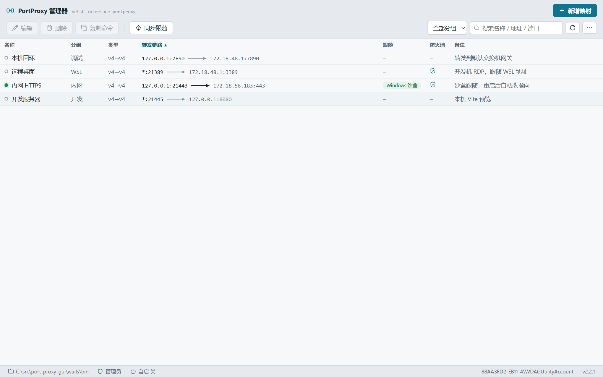
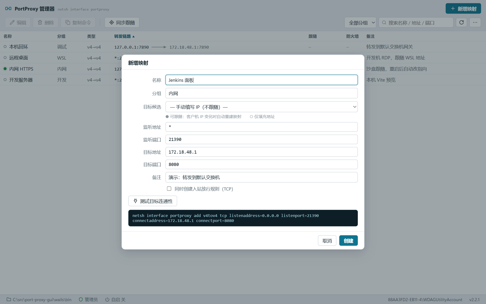
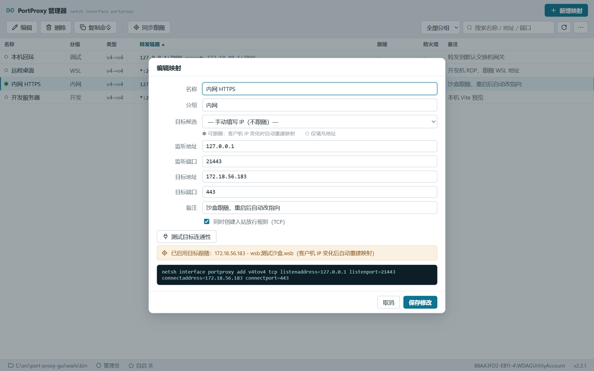
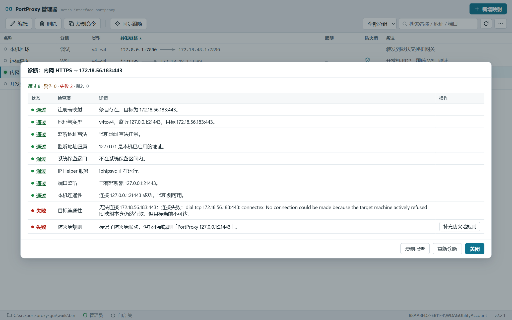

# PortProxy 管理器

Windows 上管理 TCP 端口转发的图形界面（Go + Wails v3）。不用再记 `netsh interface portproxy` 的长参数，
鼠标填表就能增删改；**WSL / 虚拟机 / Windows 沙盒换 IP 后，映射会自动跟随更新**，不会悄悄失效。



---

## 下载与安装

从 [Releases](https://github.com/netcaty/port-proxy-gui/releases) 下载：

| 产物 | 说明 |
|---|---|
| `portproxymanager-wails-<版本>-amd64-setup.exe` | 安装包。按当前用户安装到 `%LOCALAPPDATA%\Programs\PortProxyManager`，安装过程不需要管理员权限 |
| `portproxymanager-wails-<版本>-amd64-portable.zip` | 绿色版。解压后双击 `portproxymanager.exe`；数据保存在程序同目录 |

- 首次写映射时会弹一次 UAC（写 HKLM + `netsh` 必须提权），之后都在界面内操作；取消 UAC 则进入只读模式。
- 卸载只删程序文件和快捷方式，**保留 `meta.json` / `settings.json` / `backups` / `logs`** 等业务数据。
- 支持 Windows 10 / Server 2016 及以上，需要 WebView2 运行时（安装包自带引导程序）。
- 安装包未签名，SmartScreen 可能提示；可自行签名（`wails3 task sign:installer`）。

---

## 核心功能

- **映射增删改**：表单填写，实时预览等价的 `netsh` 命令；写入后重读注册表核对，失败自动回滚。
- **目标跟随**：把目标设为 WSL 发行版、Hyper-V / VMware / VirtualBox 虚拟机或 Windows 沙盒；
  IP 变化后自动探测并重建映射。虚拟机优先按 MAC 认回，WSL 按发行版名，沙盒按 `.wsb` 文件名。
- **一键诊断**：注册表 → 地址类型 → 监听写法 → 地址归属 → 保留端口 → IP Helper → 端口监听 →
  本机连通性 → 目标连通性 → 防火墙，失败项直接给修复按钮。
- **日常使用**：注册表监听自动刷新、分组/搜索/备注、导入导出 JSON（差异预览）、自动快照、
  托盘常驻、单实例、开机自启、防火墙联动、IP Helper 管理。
- **无人值守**：`--install-sync` 注册计划任务，GUI 退出后仍每 5 分钟同步一次跟随目标。

### 新增映射

名称 / 分组 / 备注只用于展示；进入命令行的只有校验过的地址和端口。



### 跟随映射



### 十步诊断



---

## 命令行

GUI 主程序是 windowsgui 子系统，交互式 cmd 不会等待它。命令行场景请使用同目录的
`portproxymanager-cli.exe`（安装包和绿色版都已包含）。

```bat
portproxymanager-cli.exe --dump --json
portproxymanager-cli.exe --hints
portproxymanager-cli.exe --sync
portproxymanager-cli.exe --install-sync
```

| 参数 | 说明 |
|---|---|
| `--dump` | 以文本输出当前全部映射后退出（只读，不需要管理员） |
| `--hints` | 探测并输出全部目标地址候选后退出（只读） |
| `--sync` | 立即执行一次目标跟随同步后退出（写入需要管理员） |
| `--install-sync` | 注册「无人值守跟随同步」计划任务（登录启动 + 每 5 分钟） |
| `--remove-sync` | 删除该计划任务 |
| `--json` | 与 `--dump` / `--sync` 一起使用，输出 JSON |
| `--out=<文件>` | 与 `--dump` / `--sync` 一起使用，同时把结果写入文件 |
| `--data-dir=<路径>` | 指定数据目录（meta.json / settings.json / logs / backups） |
| `--tray` | 启动后直接最小化到托盘（GUI） |
| `--no-elevate` | 不自动提权（GUI 以只读模式运行） |
| `-h`, `--help` | 显示帮助 |

`--sync` 退出码：`0` 成功/无变化/跳过，`1` 读取或更新失败，`2` 目标已变化但当前未提权。

---

## 从源码构建

需要 Go 1.26+、Node 18+、[wails3 CLI](https://v3.wails.io/)（版本与 `wails/go.mod` 对齐）和 NSIS 3（打安装包时）。
源码在 `wails/` 目录。

```bat
cd wails

:: 开发（前端热重载）
wails3 dev

:: 生产构建：GUI + CLI 伴生程序
wails3 task build:all
:: → bin\portproxymanager.exe、bin\portproxymanager-cli.exe

:: 打安装包（默认按用户安装，自动先构建 GUI + CLI）
wails3 task package
:: → bin\portproxymanager-wails-<版本>-amd64-setup.exe

:: 所有用户安装（装到 Program Files，需要管理员）
wails3 task package INSTALL_SCOPE=machine
```

绿色版：把 `bin\portproxymanager.exe`、`bin\portproxymanager-cli.exe` 和一份说明文件放进同一目录压缩即可。

---

## 数据目录

优先级：`--data-dir` → exe 同目录 → `%ProgramData%\PortProxyManager`（实测可写才用）。

- 绿色版与按用户安装时数据在程序目录；装到 `Program Files` 时自动落到 `%ProgramData%`。
- 数据格式与历史版本互通，但**不要同时运行两个实例**（并发写会冲突）。

---

## 限制

- 只支持 TCP：`netsh portproxy` 本身不支持 UDP。
- 目标跟随需要程序运行并提权；WSL 需运行、虚拟机需开机，探测不到时保留最后已知地址。
- 删除不可逆，有二次确认和自动备份兜底。

更多实现细节见 [`wails/README.md`](wails/README.md)。
