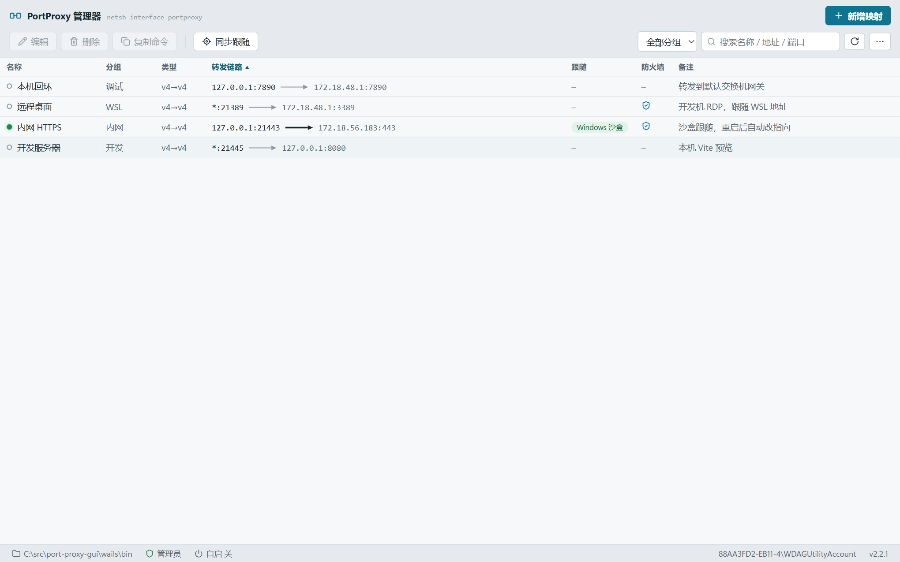
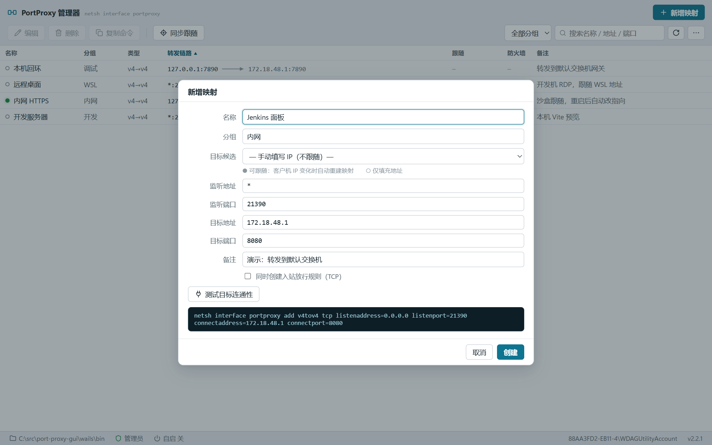
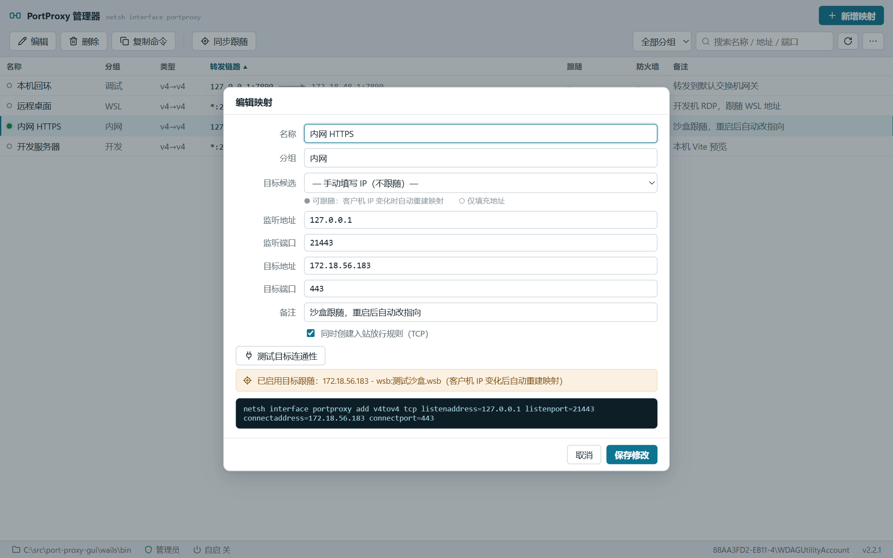
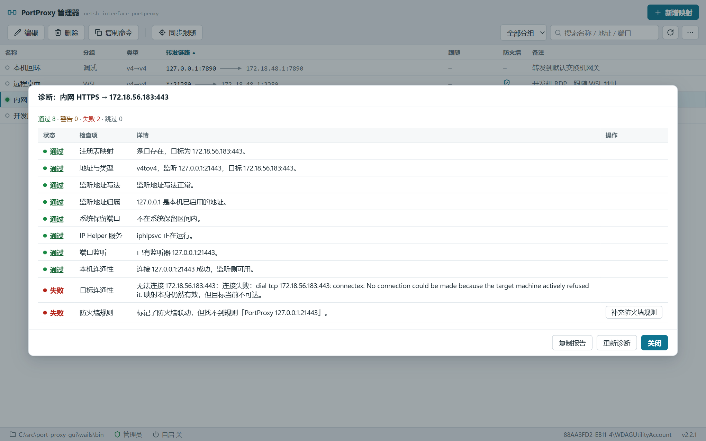

# PortProxyManager（Go + Wails v3 版）

`netsh interface portproxy` 的 Windows 图形界面 —— C# WinForms 版（仓库根目录）的 Go + Wails v3 重写。
单文件 exe，自带安装包；**WSL / 虚拟机 / Windows 沙盒换 IP 后，映射会自动跟随更新**。

> 本目录是独立 Go module，不影响根目录的 C# 工程与 `winui/` 工程。三版共用同一数据格式与数据目录。



---

## 安装

从 Releases 下载 `portproxymanager-wails-<版本>-amd64-setup.exe` 直接运行（绿色版是同页的 `...-portable.zip`）：

- **默认按用户安装**（`%LOCALAPPDATA%\Programs\PortProxyManager`），安装过程不需要管理员权限；
- 安装包内含主程序、`portproxymanager-cli.exe` 命令行伴生程序和 WebView2 引导程序；
- 首次启动写映射时会弹一次 UAC（写 HKLM + `netsh` 必须提权），之后都在界面内操作；
- 卸载只删程序文件，**保留 `meta.json` / `settings.json` / `backups` / `logs`** 等业务数据；
- 支持 Windows 10 / Server 2016 及以上；安装包未签名，SmartScreen 可能提示，可自行签名（`wails3 task sign:installer`）。

装到 `Program Files`（所有用户）也能用：

```bat
wails3 task package INSTALL_SCOPE=machine
```

> 不建议发 MSIX：包身份会让写 HKLM 与 `netsh` 命中注册表虚拟化，行为失真。与 WinUI 工程放弃 MSIX 是同一个理由。

不想安装时，直接运行 `bin\portproxymanager.exe` 即可（便携模式，数据默认落在 exe 同目录）。

---

## 截图

### 新增映射：表单 + netsh 预览

名称 / 分组 / 备注只用于展示；进入命令行的只有校验过的地址和端口。填表时实时生成等价的 `netsh` 命令。



### 编辑跟随映射

目标切到「跟随目标」后，程序会在启动、网络变化和定时检查时重新探测客户机 IP，变化才重建映射。
虚拟机优先按 MAC 认回，WSL 按发行版名，Windows 沙盒按 `.wsb` 文件名。



### 十步诊断

注册表 → 地址与类型 → 监听写法 → 地址归属 → 保留端口 → IP Helper → 端口监听 → 本机连通性 → 目标连通性 → 防火墙。
失败项直接给修复按钮（重启 IP Helper、重建为 `0.0.0.0`、补防火墙规则…），报告可一键复制。



---

## 快速开始

1. 启动程序，UAC 点「是」（取消则进入只读模式，仍可浏览）。
2. 主界面列出当前全部映射；「新增映射」或双击一行编辑。
3. 填监听地址/端口、目标地址/端口。目标是 WSL / 虚拟机 / 沙盒时，把「目标候选」切到跟随并选中设备。
4. 创建后会立刻重读注册表核对，确认落地才报成功；失败自动回滚。

快捷键：`Ctrl+N` 新增、`Del` 删除、`/` 聚焦搜索、`F5` 刷新。

---

## 目标跟随

WSL2（NAT）和虚拟机重启后 IP 可能变化，写死的 portproxy 会静默失效。启用跟随后：

- **自动更新**：启动 4 秒首同步、网络地址变化即时触发（3 秒防抖）、每 5 分钟定时兜底，也可手动「同步跟随」；
- **认得住机器**：Hyper-V / VMware / VirtualBox 优先按 MAC，WSL 按发行版名，沙盒按 `.wsb` 文件名；
- **不会改丢**：探测不到时保留最后已知地址；已被外部删除的映射不会被重建；
- **镜像网络**：WSL mirrored 网络固定跟随 `127.0.0.1`；
- **无人值守**：`--install-sync` 注册计划任务，登录时启动 + 每 5 分钟跑一次 `--sync`，GUI 退出后仍然生效。

跟随写入需要管理员权限；WSL 需运行、虚拟机需开机、沙盒需启动。

---

## 功能一览

| 功能 | 状态 | 说明 |
|---|---|---|
| 映射增删改 + netsh 预览 | ✅ | 写后重读注册表核对；修改失败自动回滚 |
| 注册表监听自动刷新 | ✅ | `RegNotifyChangeKeyValue` 手写 syscall |
| 数据目录（meta/settings/backups/logs） | ✅ | 与 C# 版**共用格式、共用数据目录**，可原地互换 |
| 目标跟随（WSL/Hyper-V/VMware/VBox/沙盒） | ✅ | 见上一节 |
| 无人值守跟随同步 | ✅ | `--install-sync` 计划任务；登录启动 + 每 5 分钟 `--sync` |
| 沙盒检测 | ✅ | 进程 + 可见窗口确认；ARP + Hyper-V 启发式 + ICMP 去重 |
| ARP/网关候选 + 设备识别 | ✅ | `GetIpNetTable2`、MAC OUI、Default Switch 锚点 |
| 一键诊断（十步检查+修复） | ✅ | 见上文 |
| 目标连通性测试 | ✅ | 编辑对话框按钮 + 行右键菜单 |
| 防火墙联动 / IP Helper 管理 | ✅ | 规则名只由 IP:端口 生成 |
| 导入导出 JSON（差异预览）/ 自动快照 | ✅ | 文档结构与 C# 版互通 |
| 系统托盘 + 关窗进托盘 | ✅ | Wails v3 原生 tray，右键菜单含自启开关 |
| 单实例互斥（再次启动激活旧窗口） | ✅ | 命名 Mutex + 激活事件，容错 AbandonedMutex |
| UAC 自提权（取消退回只读） | ✅ | `ShellExecuteExW "runas"`，错误码 1223 区分 |
| 开机自启（计划任务，登录不弹 UAC） | ✅ | `schtasks /xml`，UTF-16 BOM，RunLevel=HighestAvailable |
| CLI 只读模式 | ✅ | `--dump [--json] [--out=] [--data-dir=]`，JSON 字段与 C# 版一致 |
| CLI 同步与任务管理 | ✅ | `--sync [--json] [--out=]`、`--install-sync`、`--remove-sync` |
| CLI 伴生程序 | ✅ | `portproxymanager-cli.exe`，安装包自带 |
| `--selftest` 自检 | ⬜ 未移植 | |

---

## 命令行

GUI 主程序是 windowsgui 子系统，交互式 cmd 不会等待它。所有命令行场景请用
`portproxymanager-cli.exe`（安装目录或 `bin\` 下都有）。

```bat
:: 只读导出（JSON 字段与 C# 版一致）
portproxymanager-cli.exe --dump
portproxymanager-cli.exe --dump --json --out=%TEMP%\dump.json

:: 地址候选 / 跟随提示
portproxymanager-cli.exe --hints

:: 手动跑一轮跟随同步；退出码 0 成功/无变化，1 失败，2 目标变化但当前未提权
portproxymanager-cli.exe --sync --json --out=%TEMP%\sync.json

:: 注册 / 删除无人值守计划任务（需要管理员权限）
portproxymanager-cli.exe --install-sync
portproxymanager-cli.exe --remove-sync
```

任务名 `PortProxyManagerFollowSync`，以 `HighestAvailable` + `InteractiveToken` 运行，不弹 UAC；
动作优先指向同目录的 `portproxymanager.exe --sync --no-elevate`（GUI 子系统，计划任务运行时不会闪控制台）。
与 GUI 内的定时同步通过命名互斥锁 `Local\PortProxyManager.FollowSync` 串行化。

---

## 数据目录

解析优先级与 C# 版一致：`--data-dir` → exe 同目录 → `%ProgramData%\PortProxyManager`（实测可写才用）。

- 按用户安装时 exe 同目录可写，数据就落在 `%LOCALAPPDATA%\Programs\PortProxyManager`；
- 装到 `Program Files` 时自动落到 `%ProgramData%\PortProxyManager`；
- 与 C# 版 / WinUI 版**不要同时运行**（并发写会冲突）。

---

## 构建与打包

依赖：Go 1.26+、Node 18+、[wails3 CLI](https://v3.wails.io/)（版本与 `go.mod` 的 `github.com/wailsapp/wails/v3` 对齐）、
NSIS 3（打安装包时）。

```bat
:: 开发（前端热重载）
wails3 dev

:: 生产构建：GUI + CLI 伴生程序
wails3 task build:all
:: → bin\portproxymanager.exe、bin\portproxymanager-cli.exe

:: 打安装包（默认按用户安装，自动先构建 GUI + CLI）
wails3 task package
:: → bin\portproxymanager-wails-<版本>-amd64-setup.exe

:: 所有用户安装（装到 Program Files，需要管理员）
wails3 task package INSTALL_SCOPE=machine
```

安装包由 NSIS 生成：

- 默认 `INSTALL_SCOPE=user`，`RequestExecutionLevel=user`，不弹 UAC；
- 打包内容 = GUI 主程序 + `portproxymanager-cli.exe` + WebView2 引导程序；
- 卸载段只删程序文件、快捷方式和卸载项，保留数据目录；
- 可选签名：`wails3 task sign:installer`（需配置证书，见 `build/windows/Taskfile.yml`）。

---

## 与 C# 版的有意差异

- **去掉 `wsb.exe` CLI 链路**：不再调用 `wsb list` / `wsb ip`，也没有包内路径解析与提权令牌注入；
- **沙盒运行确认只靠进程 + 可见窗口**（`WindowsSandbox` / `WindowsSandboxClient` / `WindowsSandboxRemoteSession`）；
- **沙盒 IP 只走 ARP + Hyper-V 启发式 + ICMP 去重**；`.wsb` 文件名仍从进程命令行（PowerShell CIM）提取；
- `--selftest` 未移植。

---

## 目录结构

```
main.go / app.go        入口 + Wails 服务层（38 个绑定方法）
internal/               按 C# Services 一一对应：
  registryio  注册表读 + 变更监听    netsh      映射写通道（写后核对）
  hints       地址候选/沙盒确认/WSL/VM 探测    follow   目标跟随引擎
  diagnoses   十步诊断             firewall   防火墙联动
  iphelper    iphlpsvc 管理        backup     导入导出/快照
  autorun     计划任务自启         singleinst 单实例
  synctask    无人值守同步计划任务  syncguard  跨进程同步互斥
  netwatch    网络地址变化监听      elevationx UAC 自提权
  cli         --dump / --sync 等   paths/logging/meta/settings/proc/winansi/...
frontend/               Vue 3 + TS（主表格、Entry/Diagnostics/Import/Log 对话框）
build/windows/          NSIS 脚本、图标、版本信息、WebView2 引导
../docs/screenshots/    仓库级 README 截图
```

---

## 系统集成实现要点

- **邻居表（ARP）**：`GetIpNetTable2` 读结构化的 IP/MAC/接口索引，不解析 `arp.exe`，不受控制台代码页影响。
- **默认网关**：`GetIpForwardTable2` 取 `0.0.0.0/0` 路由的 NextHop（失败才回退 PowerShell）。
- **网络变化**：`NotifyIpInterfaceChange` 回调 + 3 秒防抖触发跟随同步；注册失败自动退回 5 分钟定时器。
- **子进程编码**：调用方显式声明编码；ANSI（`winansi`）只用于 netsh / schtasks / VBoxManage / vmrun 这类带本地化文本的输出，ping 等纯 ASCII 匹配用 UTF-8。
- **写后核对**：netsh 退出码 0 不代表落地，写入后必须重读注册表核对；「编辑」= 先删后加，失败自动回滚。
- **安全边界**：名称/分组/备注/跟随标识只用于展示与本地匹配，绝不拼进命令行；只支持 TCP。
